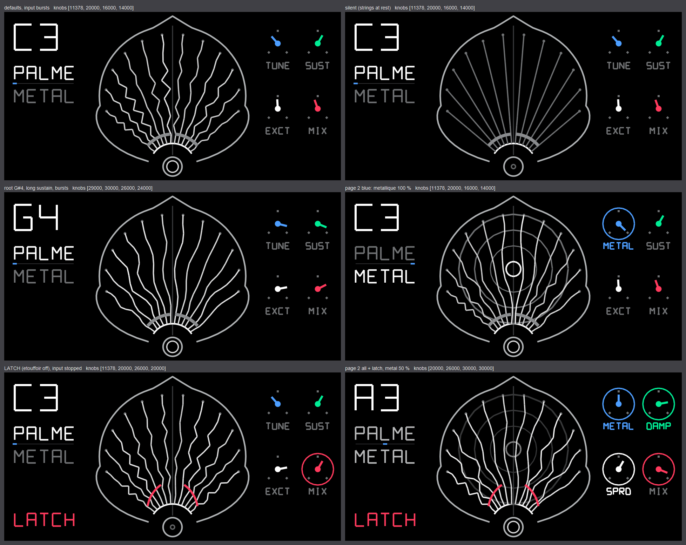

# palme — Ondes Martenot diffuseurs (FX, order 4)

Maurice Martenot did not trust a plain loudspeaker with his instrument. Next to the "Principal" he built
*diffuseurs* that colour the sound acoustically. The **Palme** (1950) is a palm-leaf shaped soundboard with 12
strings, tuned chromatically and excited by a speaker at its foot, so every note blooms into sympathetic
resonance. The **Métallique** replaced the membrane with a gong. Ondistes press a pedal or lever to lift the
dampers and let the Palme ring on. This FX models the strings with Karplus-Strong loops that you can morph into
gong modes, and the LATCH lifts the dampers for good.

## Knobs

| knob | page 1 | page 2 (press) |
|---|---|---|
| blue | **tuning**: root note C2 … B4 (the 12 strings are root … root + 11) | **métallique**: morph palme → gong (8 free-plate modes 1, 1.73, 2.33, 3.91, 4.11, 6.30, 6.71, 7.34 + 4 detuned twins that beat; the sum drives a soft clip whose residue blooms back into the strings while they are struck) |
| green | **sustain**: string T60 0.25 s … 30 s | **damping**: loop filter colour, dark felt … bright wire |
| white | **excite**: input drive into the strings + brightness of the excitation | **spread**: detune 0 … ±35 cents (fixed pattern per string) |
| red | **mix**: dry … dry + strings … strings | press = **LATCH, "étouffoir off"** (not saved) |

LATCH: while input plays, the loops sit at unity gain and collect what they hear. About 0.3 s after the input
stops, each string's *fundamental* is held indefinitely by an AGC (16-point DFT energy, PI control on top of
the computed loss compensation). Harmonics still fade with the damping, so the chord turns into a drone. New
input adds to it, and releasing LATCH lets everything decay. Every loop has a soft limiter, a proportional DC
servo and saturating arithmetic, so nothing can run away.

Screen (`palmediff.svg` + `gen_svg.py`): the palm leaf with its 12 strings fanning out from the loudspeaker.
Each string is drawn from its own delay line: one period of what it rings, laid along the string under a
standing-wave window, with amplitude and brightness following its level. Métallique fades in the gong behind
the leaf. The felt damper sits across the strings, and LATCH swings it open like two red wings. The speaker
cone breathes with the input. The root note, PALME / METAL, and page-aware dials are on screen too.

## DSP in short
- 3-tap loop kernel per string: linear-interpolated fractional delay ⊗ KS averager (1 − b, b) with the decay
  gain folded into the taps (Q24, sigma-delta to Q15 across blocks). The averager's delay b is taken off the
  line length, so tuning is exact.
- Ring buffers, 1024 samples per string (the longest look-back is 682: C2 = 674.2 samples + taps + the gate
  clear), with a 2-sample mirror of each ring's end in front of it. Writes never wrap (the write index is a
  multiple of 64). A string's block is one run, or two where its reads cross the ring's start, so the
  string-major inner loop has no masks (Blackfin fract16 builtins, 17 instructions per string-sample).
- Analysis, pitch glide, gain and latch AGC for 2 strings per block (each string every 8.7 ms).
- No block is expensive. There is no periodic bulk work. The FX's `init` runs inside the audio interrupt
  (the dispatcher calls it on the first render after the FX is selected), so it only resets state; the
  scratch is cleared over the first 8 blocks (12 ms) while the strings are silent and the dry part passes.
  The gate's history clear (at most 2 strings per block) uses 32-bit stores and is skipped while a gated
  string is still zero. Filling the DC servo window skips samples known to be zero, so there is no burst
  of reads at the start or after a gate.

## Verification (host harness, UBSan on, scripts in the build agent's scratch dir)
- **Tuning**: noise burst through all 36 roots × 12 strings, FFT peak vs equal temperament. Worst **0.76 cents**
  (dark, mid and bright damping). Spread at max matches its pattern within 0.5 cents. Métallique modes sit
  within 1.7 cents of the plate ratios.
- **Latch**: 5 min drone after plucks. Each string's fundamental is constant to ±0.1 dB, output steady at
  −18.3 dB RMS, DC −0.5 LSB. Métallique latch: −13.0 dB steady.
  - Continuous sine plus latch for 10 min: flat at −17.4 dB (bounded by the per-string limiter).
  - Noise plus latch, then 4 min of silence: steady.
  - Latch on silence: stays silent. Unlatch: decays to digital zero within 5 s.
- **Tails**: 40 random unlatched settings all decay to digital zero. 40 extreme/random latched settings: no
  traps, |DC| ≤ 1.5 LSB.
- **Positions**: position 0 is bit-identical whether or not positions 1 and 2 run other settings.
- **Ring-buffer rewrite = the linear-line version, bit for bit** (12 random runs of 30,000 blocks at all 3
  positions, 26 min of audio in all: plucks, chords, noise, sines, full-scale squares, DC, impulses, long silences
  with gates, latch on/off/toggling, métallique, damping, spread and tuning sweeps and jumps, out-of-range
  page-2 words, dirty scratch, re-inits mid-run; plus a 5 min latch drone at 3 settings). Output and screen
  levels are identical to the old code started 8 blocks later. That delay is the only change: after the FX
  is selected, the strings begin 11.6 ms later, as if the input had started 11.6 ms later. The old code
  overran the audio deadline in that block anyway (see CPU). Mutation checks (no mirror, no gate clear,
  wrong zero-tracking or window bound) all make the comparison fail, so the test can catch these errors.
- **Levels** (plucked saws, default knobs, wet): −14 dB RMS, peak −5 dB. Excite range −34 … −9 dB RMS. The
  `audio.py` render peaks at −1.4 dBFS.

## CPU
`bfin-elf-gcc -O2 -mcpu=bf524` objdump count. The libgcc divisions are counted at about 40 to 60 instructions.

| part | per block | per sample |
|---|---|---|
| 12 string loops (12 × 64 × 17) | 13056 | 204 |
| output (12-line sum, clip, mix) | 4685 | 73 |
| input + excitation flag | 1867 | 29 |
| per-string taps, DC servo, run setup (12 × 157) | 1884 | 29 |
| slow path (2 strings × ~850, incl. 1/P division) | 1700 | 27 |
| block overhead (knobs, 4 parameter divisions, latch) | 564 | 9 |
| **typical block** | **~23.8k** | **~371** |

That is about **4.1 %** of 400 MHz at one instruction per cycle. Counted the same way, the old linear-line
code was ~361 per sample (4.0 %) in a typical block; its earlier README figure of ~335 (3.7 %) undercounted. All divisions run once per block (none
per sample): 4 knob-range scalings (`op1_fx_param_q15`), `pos % 3`, and 1/P for 2 strings.

**Worst-case block.** A cost model applies these per-path counts to every block of the equivalence runs
(300,000 blocks):

| | old (linear lines) | new (rings) |
|---|---|---|
| median block | 23.1k | 23.8k |
| average block | 23.6k | 23.8k |
| worst block | 113.5k (**4.9 ×**): `init` cleared 170 KB inside the audio interrupt | 25.1k (**1.06 ×**) |
| every 96 blocks (7 per second) | 36.7k (1.6 ×) moving 12 × 2 KB of history; up to 40.9k (1.8 ×) together with gate clears | none |
| gate block (string dies) | up to +5.4k: 2 × (~690 16-bit stores + ~670-sample window refill) | +0.8k: 2 × 345 32-bit stores, refill skipped |
| first 8 blocks after selection | none | 1.7–2.1k (scratch clear) |

The old spikes were also SDRAM-bound. A rewind moved 26 KB, and init wrote 87k 16-bit words to the
scratch. In SDRAM that costs far more cycles than the instruction count. In the new code every block touches
about the same amount of memory, and the active set is 25.7 KB instead of 170 KB, which suits the cache
much better.

## Known limitations / hardware risks
- The CPU figure is an instruction count. The rings live in the SDRAM scratch buffer (24 sequential streams
  over 25.7 KB), so cache behaviour on the device decides the real load. Check on the T1 monitor.
- When the FX is selected, the strings start after 8 blocks (12 ms), during the scratch clear. The dry part
  passes meanwhile.
- Uses `__builtin_bfin_mult_fr1x16/1x32` and `add/sub_fr1x16/1x32` (plain C on the host).
- Scratch use: 25,728 of 176,460 bytes. The screen reads the rings from the GUI thread (racy, harmless).
- With latch on and input playing continuously, energy accumulates up to the per-string limiter (by design: the
  damper is up). Max excite + max métallique + latch is a loud, clipped roar (bounded).
- Low-level tails below about −42 dB fade faster (release), and strings under −68 dB are gated to zero, to
  avoid fixed-point limit cycles.
- Retuning and morphing glide (at most P/128 per 8.7 ms) instead of jumping.

Files: `palme.c` (DSP + screen), `palme_geom.h` and `palmediff.svg` (from `gen_svg.py`), `plugin.json`,
`palme_preview.png` (render.py with palme states), `palme_audio.wav` (audio.py, defaults). A longer demo (plucks →
latched drone, then métallique) is on https://github.com/ultralazr/op1-musica-obscura.
